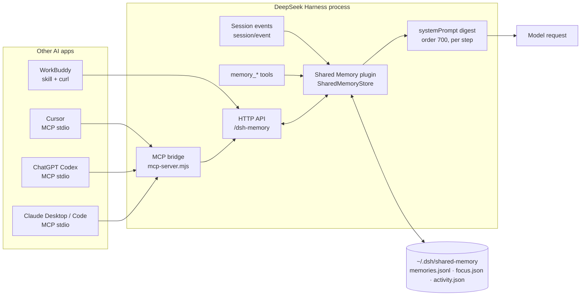

# Shared Memory

[中文](README.md) | English

A **cross-session, cross-app, cross-platform memory layer** (packaged as a DeepSeek Harness plugin today) that gives every session — and every other AI app — one shared memory: the user's messages, long-term preferences, ongoing projects, and "what I'm working on right now".

- Shape: **Harness Host plugin** + **zero-dependency MCP stdio bridge** + **reusable agent skill**
- Storage: `~/.dsh/shared-memory/`
- Package / loader row: `@local/shared-memory` / `shared-memory`
- Version: 1.5.0 · License: MIT

> The Chinese name is now **AI 跨平台记忆增强 1.0**; the English name stays **Shared Memory**. Internal identifiers (package, skill id, store path) are unchanged for compatibility.

> **Not just a skill.** An agent skill is only the client-side adapter that teaches WorkBuddy (or any skill-aware agent) to call the plugin's local HTTP API. The memory service itself is the Harness plugin; other apps connect through the MCP bridge or HTTP.

## Architecture



A hand-drawn version lives at [docs/assets/architecture.svg](docs/assets/architecture.svg).

## Demo

```text
$ node ~/.dsh/shared-memory/mcp-server.mjs
# MCP initialize -> tools/call memory_status
Shared memory service is running (dsh-shared-memory v1.1.0)
Address: http://127.0.0.1:57545/dsh-memory (source: runtime.json)
Store:   /Users/you/.dsh/shared-memory
Stats:   34 memories / 18 captured messages / 3 sessions / focus: yes

# tools/call memory_search { "q": "plugin" }
Query "plugin": 3 matches, showing 3
- [project · 12 minutes ago] The shared-memory plugin now has a two-tier storage...
- [note · 1 hour ago] First install failed because output.schema used the wrong...
- [profile · 2 hours ago] User prefers concise answers and Chinese...
```

## Repository layout

```
├── index.js                  # Host plugin: capture / store / tools / prompt digest / HTTP API
├── cordis.patch.yml          # bundle row + default config
├── mcp/server.mjs            # zero-dependency MCP stdio bridge (copied to ~/.dsh/shared-memory/)
├── ui/index.html             # browser viewer/editor (/dsh-memory/ui)
├── skills/shared-memory/     # reusable agent skill (WorkBuddy and friends)
├── docs/API.md               # frozen HTTP / storage / MCP contract
├── docs/CONNECT-APPS.md      # per-app setup guides
├── docs/HOW-IT-WORKS.md      # design and data-flow notes
├── test/host-smoke.mjs       # host-half integration test
├── test/mcp-smoke.mjs        # MCP protocol smoke test (35 assertions)
├── locale/en.json · zh.json
└── icon.svg
```

## Two ways to run

| Mode | Needs Harness | Capabilities | Best for |
|---|---|---|---|
| **Harness plugin** (default) | ✅ | auto-capture session messages, prompt digest, model tools, HTTP, MCP | day-to-day use inside DeepSeek Harness |
| **Standalone hub** `standalone/server.mjs` | ❌ | storage / search / focus / HTTP / MCP (no auto-capture, no prompt digest) | Windows, Linux, servers, machines without Harness |

Both use the same store (`~/.dsh/shared-memory/` by default) and the same `runtime.json`, so MCP client configs do not change.

> ⚠️ Run only one of them per store directory — they share the single-writer assumption.

### Quick start (standalone hub, cross-platform)

Requires Node.js ≥ 18, nothing else.

```bash
git clone https://github.com/shadyyoung/dsh-shared-memory.git
cd dsh-shared-memory
node standalone/server.mjs            # http://127.0.0.1:7400/dsh-memory
```

## Install

Prerequisites: DeepSeek Harness Desktop (Cordis plugin system, `plugin_manager`), Node.js ≥ 18.

1. Clone the repo:
   ```bash
   git clone https://github.com/shadyyoung/dsh-shared-memory.git
   ```
2. Install the bundle with an absolute path:
   ```
   plugin_manager: install_bundle  target=/absolute/path/to/dsh-shared-memory
   ```
   After installation, `Tool.listTools` should list `memory_remember`, `memory_search`, `memory_forget`, `memory_current`.
3. Connect other AI apps: see [docs/CONNECT-APPS.md](docs/CONNECT-APPS.md). The MCP bridge is `~/.dsh/shared-memory/mcp-server.mjs` and is materialized by the plugin on activation.
4. Optional: copy the skill into any skill-aware agent, e.g. WorkBuddy:
   ```bash
   mkdir -p ~/.workbuddy/skills/shared-memory
   cp skills/shared-memory/SKILL.md ~/.workbuddy/skills/shared-memory/
   ```

## What it does

| Capability | Detail |
|---|---|
| Capture user messages | Listens to `session/event` `user/message` and writes a **short-term raw-message cache** (30-day retention by default; subagent/composed messages skipped) |
| Current focus | One structured "what is the user doing now" document, updated automatically from substantive messages or explicitly by any app |
| Session activity | Latest user/assistant message, message count, cwd and title per root session — visible across sessions |
| Prompt digest | Injects `## Shared Memory` (≤1200 chars), fenced with `<memory-data>`, plus a **BM25 relevance** "related memories" section for the current topic |
| Search | In-memory **BM25 inverted index** (CJK bigrams + latin words, tags indexed); `sort=relevance|newest` |
| Model tools | `memory_remember` / `memory_search` / `memory_forget` / `memory_update` / `memory_restore` / `memory_current` |
| Viewer / editor UI | `/dsh-memory/ui`: browse, search, edit, trash/restore, edit history, focus editor, **backup/restore**, JSONL export |
| Automatic backup | Full gzipped snapshot every 24h to `~/.dsh/shared-memory-backups/` (keeps 14); manual backup + one-click restore in the UI |
| HTTP API | `http://127.0.0.1:<port>/dsh-memory` (port from `runtime.json`) |
| MCP bridge | `~/.dsh/shared-memory/mcp-server.mjs`, zero dependencies, stdio JSON-RPC |

## Two-tier memory

| Tier | Kind | Retention | Purpose |
|---|---|---|---|
| Raw cache | `message` | 30 days (`messageRetentionDays`), max 3000 | recall recent exact words |
| Durable | `profile / preference / goal / project / task / note` | forever (until `memory_forget`) | identity, preferences, decisions, projects, tasks, focus |

Why: storage is cheap (a few thousand records ≈ ~1 MB), but prompt noise is not. Long-term memories are only what the model judged worth keeping.

## Storage format

```
~/.dsh/shared-memory/
├── memories.jsonl    # one JSON record per line (single writer: the Harness process)
├── focus.json        # current focus + next steps
├── activity.json     # per-session recent activity
├── runtime.json      # API base / port / token, used by the MCP bridge for discovery
├── mcp-server.mjs    # MCP bridge
├── digest.md         # human-readable snapshot
└── token             # only when apiToken is configured
```

Record: `{ id, kind, text, tags, source:{app,sessionId,cwd,title}, createdAt }`.

## Configuration

Edit [cordis.patch.yml](cordis.patch.yml) and re-enable the bundle.

| Field | Default | Description |
|---|---|---|
| `storeDir` | `~/.dsh/shared-memory` | storage directory |
| `captureUserMessages` | `true` | capture root-session user messages (short-term cache) |
| `messageRetentionDays` | `30` | raw-message retention; 0 = forever |
| `promptDigest` | `true` | inject the digest into the system prompt |
| `maxDigestChars` | `1200` | digest size cap |
| `maxStoredMessages` | `3000` | raw-message count cap |
| `maxActivitySessions` | `200` | session activity entries kept |
| `apiEnabled` | `true` | register HTTP routes |
| `apiPath` | `/dsh-memory` | route prefix |
| `apiToken` | `""` | when set, `/api/*` requires `Authorization: Bearer <token>` |
| `autoFocusMinutes` | `90` | auto-focus refresh interval; 0 disables |
| `writeHumanDigest` | `true` | maintain `digest.md` |
| `trashRetentionDays` | `30` | trash retention; 0 = keep forever |
| `maxRevisions` | `20` | edit-history versions kept per memory; 0 = none |
| `maxRelevantMemories` | `4` | related-memory lines in the digest; 0 = off |
| `backupDir` | `~/.dsh/shared-memory-backups` | backup directory (outside the store by default; point it at iCloud/Dropbox if you like) |
| `backupKeep` | `14` | number of backups kept |
| `autoBackupHours` | `24` | automatic backup interval in hours; 0 = off |

## Verify

```bash
# service health (port from runtime.json)
curl -s "$(node -e "console.log(require(process.env.HOME+'/.dsh/shared-memory/runtime.json').apiBase)")/health"

# local tests, no running Harness required
node test/host-smoke.mjs        # tools, capture, prompt digest, HTTP API, auth
node test/mcp-smoke.mjs         # MCP protocol, 35 assertions
node test/standalone-smoke.mjs  # standalone hub + MCP bridge, no Harness needed
```

Verified on 2026-10-26 against DeepSeek Harness Desktop with Node 24: both suites pass; live HTTP `/health` OK; MCP `memory_status` / `memory_search` / `memory_current` read and write the same store; the digest is injected into the system prompt.

## Known limitations

- No Web UI panel: inspect or edit via tools, HTTP, `digest.md`, or the JSONL directly.
- The HTTP service lives inside Harness: when Harness is closed the bridge returns a readable "service is not running" error and recovers automatically.
- Local-only by default; set `apiToken` before exposing it beyond loopback.
- Memory is plaintext JSONL and contains raw user messages; use `captureUserMessages: false` if that is not acceptable.
- Plain ChatGPT chat / web cannot connect to a local stdio MCP server (remote Connector only).

## License

MIT
