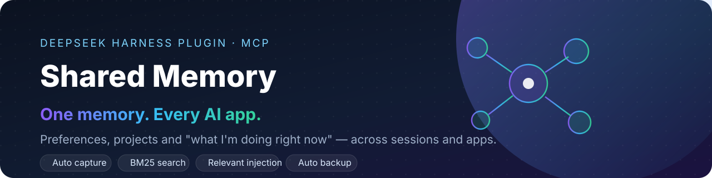

<p align="center">
  <a href="README.md">中文</a> ·
  <a href="README.en.md">English</a> ·
  <a href="README.ja.md">日本語</a> ·
  <a href="README.ko.md">한국어</a> ·
  <b>Español</b>
</p>

<p align="center">
  <a href="https://github.com/shadyyoung/dsh-shared-memory/releases">
    
  </a>
</p>

<h1 align="center">Shared Memory · Memoria AI multiplataforma</h1>

<p align="center">
  <b>Una sola memoria, compartida por todas tus apps de IA.</b><br>
  Recuerda preferencias, proyectos y «qué estoy haciendo ahora» entre sesiones, espacios de trabajo y aplicaciones.
</p>

<p align="center">
  <a href="https://github.com/shadyyoung/dsh-shared-memory/releases"></a>
  <a href="https://github.com/shadyyoung/dsh-shared-memory/actions/workflows/ci.yml"></a>
  
  = 18">
  
</p>

<p align="center">
  <a href="docs/API.md">API</a> ·
  <a href="docs/HOW-IT-WORKS.md">Cómo funciona</a> ·
  <a href="docs/CONNECT-APPS.md">Conectar apps</a> ·
  <a href="CHANGELOG.md">Cambios</a>
</p>

> [!NOTE]
> No es un Agent Skill. El skill solo es un adaptador para clientes como WorkBuddy; el servicio real es el plugin de DSH (o el hub independiente), al que otras apps llegan por MCP o HTTP.

> [!IMPORTANT]
> **Un solo escritor**: no ejecutes el plugin de DSH y el hub independiente sobre el mismo store a la vez.

## Qué es

Una capa de memoria compartida **local-first**, publicada como **plugin de DeepSeek Harness**, con un **puente MCP stdio** sin dependencias y una **API HTTP**. Cursor, Claude Desktop, ChatGPT escritorio (Codex), WorkBuddy y cualquier script leen y escriben la misma memoria.

| | Función | Qué hace |
|---|---|---|
| 🎯 | **Captura automática** | Guarda cada mensaje del usuario, el foco actual y la actividad de las sesiones |
| 🧠 | **Extracción automática** | Detecta preferencias/identidad/objetivos/proyectos y los envía a una **bandeja de pendientes**; solo lo aceptado se convierte en memoria |
| 🔍 | **Búsqueda BM25** | Índice invertido de bigramas CJK, palabras latinas y etiquetas, con ranking por relevancia |
| 💉 | **Inyección relevante** | Antes de cada petición inyecta un resumen (≤1200 caracteres) más las memorias relacionadas con el tema actual |

## Interfaz

<p align="center">
  
</p>

Abre `/dsh-memory/ui` en el navegador (el puerto cambia en cada reinicio; léelo de `~/.dsh/shared-memory/runtime.json` o ejecuta `~/.dsh/shared-memory/open-ui.sh`).

- Vistas de memorias / papelera / pendientes, resaltado de búsqueda y orden por relevancia o fecha
- Editar, borrado lógico, restaurar, borrado definitivo e historial de ediciones
- Edición del foco actual y exportación JSONL
- Copias de seguridad y restauración, importación de historiales de ChatGPT/Claude
- Estadísticas: memorias, mensajes, papelera, sesiones y número de usos

## Inicio rápido

### A. Instalar en DeepSeek Harness (recomendado)

Requisitos: DeepSeek Harness Desktop y Node.js ≥ 18.

```bash
git clone https://github.com/shadyyoung/dsh-shared-memory.git
```

Instala el bundle con `plugin_manager` (ruta absoluta):

```text
plugin_manager: install_bundle  target=/ruta/absoluta/dsh-shared-memory
cordis_inspect_query: Tool.listTools   # deberías ver memory_remember / memory_search / …
```

> [!TIP]
> Reinicia Harness tras modificar el código del plugin: los esquemas registrados por HMR pueden diferir de un arranque en frío.

### B. Otras apps de IA «listas al abrir»

```bash
cd dsh-shared-memory
npm run install-apps    # detecta y configura Cursor / Claude Desktop / Codex / Claude Code / WorkBuddy
npm run autostart       # opcional (macOS): abre DSH al iniciar sesión para mantener el servicio
npm run doctor          # verifica servicio, handshake MCP y configuración de cada app
```

- `install-apps` **hace copia de seguridad** antes de modificar la configuración.
- Las apps en ejecución deben **cerrarse por completo (`Cmd+Q`) y reabrirse** para cargar MCP.
- `npm run autostart:uninstall` elimina el elemento de inicio.

### C. Hub independiente (sin DSH, multiplataforma)

```bash
node standalone/server.mjs                       # http://127.0.0.1:7400/dsh-memory
node standalone/server.mjs --port 7400 --store ~/.dsh/shared-memory
```

Ofrece almacenamiento, búsqueda, HTTP y MCP, pero no captura automática ni inyección de contexto.

## Matriz de integración

| App | Transporte | Lectura/escritura | Configuración |
|---|---|---|---|
| DeepSeek Harness | plugin integrado | ✅ | captura + inyección + 6 herramientas |
| Cursor | MCP stdio | ✅ | `~/.cursor/mcp.json` |
| Claude Desktop | MCP stdio | ✅ | `claude_desktop_config.json` |
| Claude Code | MCP stdio | ✅ | `~/.claude.json` |
| ChatGPT escritorio (Codex) | MCP stdio | ✅ | `~/.codex/config.toml` |
| WorkBuddy | MCP stdio + skill | ✅ | `~/.workbuddy/mcp.json` (confiar una vez en el MCP local) |
| Cualquier script / navegador | HTTP | ✅ | `/dsh-memory/api/*` |
| ChatGPT web | ❌ | — | solo conectores remotos |

## Herramientas

**Herramientas DSH (6)**: `memory_remember` · `memory_search` · `memory_forget` · `memory_update` · `memory_restore` · `memory_current`

**Herramientas MCP (7)**: las mismas seis + `memory_digest` · `memory_status`

`memory_forget` mueve a la papelera por defecto (`purge: true` para borrar); `memory_update` guarda historial; `memory_restore` recupera.

## API HTTP (resumen)

Contrato completo en [docs/API.md](docs/API.md). Prefijo `/dsh-memory`:

`/health` · `/api/digest` · `/api/search` · `/api/items` · `/api/current` · `/api/remember` · `/api/forget` · `/api/restore` · `/api/purge-trash` · `/api/update` · `/api/candidates/*` · `/api/import` · `/api/backups` · `/api/backup` · `/api/restore-backup` · `/api/export` · `/ui`

## Configuración

Edita [cordis.patch.yml](cordis.patch.yml) y recarga el bundle.

| Clave | Valor por defecto | Descripción |
|---|---|---|
| `storeDir` | `~/.dsh/shared-memory` | Directorio de datos |
| `captureUserMessages` | `true` | Captura mensajes del usuario de sesiones raíz |
| `messageRetentionDays` | `30` | Retención de mensajes originales (0 = siempre) |
| `maxStoredMessages` | `3000` | Máximo de mensajes originales |
| `promptDigest` | `true` | Inyecta el resumen en cada paso |
| `maxDigestChars` | `1200` | Presupuesto del resumen |
| `maxRelevantMemories` | `4` | Líneas de «memorias relacionadas» (0 = off) |
| `autoFocusMinutes` | `90` | Refresco del foco automático (0 = off) |
| `trashRetentionDays` | `30` | Retención de la papelera |
| `maxRevisions` | `20` | Versiones de historial por memoria |
| `backupDir` | `~/.dsh/shared-memory-backups` | Copias fuera del store; puedes apuntarlo a iCloud/Dropbox |
| `backupKeep` | `14` | Copias conservadas |
| `autoBackupHours` | `24` | Intervalo de copia automática |
| `autoExtract` | `rules` | `off` / `rules` (gratis) / `llm` |
| `extractModel` | vacío | provider/model para extracción LLM (vacío = modelo por defecto) |
| `maxExtractPerDay` | `30` | Límite diario de extracción con LLM |
| `piiPolicy` | `redact` | `off` / `warn` / `redact` |
| `apiEnabled` | `true` | Activa las rutas HTTP |
| `apiPath` | `/dsh-memory` | Prefijo de rutas |
| `apiToken` | `""` | Si no está vacío exige `Authorization: Bearer <token>` |

## Arquitectura

<p align="center">
  
</p>

`session/event` → captura/extracción → `memories.jsonl` (+ índice) → resumen / herramientas / HTTP → otras apps.
Las copias viven fuera del store (cada 24 h, 14 conservadas, más una `before-restore` antes de restaurar). Detalles en [docs/HOW-IT-WORKS.md](docs/HOW-IT-WORKS.md).

## Pruebas y CI

```bash
node test/host-smoke.mjs
node test/mcp-smoke.mjs
node test/standalone-smoke.mjs
node test/search-bench.mjs
npm run doctor
```

GitHub Actions ejecuta la matriz ubuntu / macos / windows × Node 20/22.

## Estructura del repositorio

```text
index.js                 # plugin host
cordis.patch.yml         # declaración del bundle + valores por defecto
standalone/server.mjs    # hub independiente
ui/index.html            # UI web en un solo archivo
mcp/server.mjs           # puente MCP stdio sin dependencias
skills/shared-memory/    # Agent Skill (WorkBuddy, etc.)
scripts/                 # install-apps · autostart · doctor
docs/                    # API · HOW-IT-WORKS · CONNECT-APPS · assets
test/                    # host · mcp · standalone · bench
```

## FAQ

<details>
<summary><b>¿Por qué hay que reiniciar la app tras cambiar la configuración?</b></summary>

El MCP solo se lee al arrancar; las apps no recargan en caliente. Cierra por completo (`Cmd+Q`) y vuelve a abrir.
</details>

<details>
<summary><b>¿Los mensajes originales se guardan para siempre?</b></summary>

No. Caducan a los 30 días por defecto (`messageRetentionDays`). Las memorias duraderas (profile/preference/project…) se conservan hasta que las borres. Si quieres recordar algo para siempre, di «recuerda: …».
</details>

<details>
<summary><b>¿Puedo usar otras apps con DSH cerrado?</b></summary>

No: el servicio vive en DSH. Usa `npm run autostart` para abrirlo al iniciar sesión, o el hub independiente.
</details>

## Licencia

[MIT](LICENSE)
