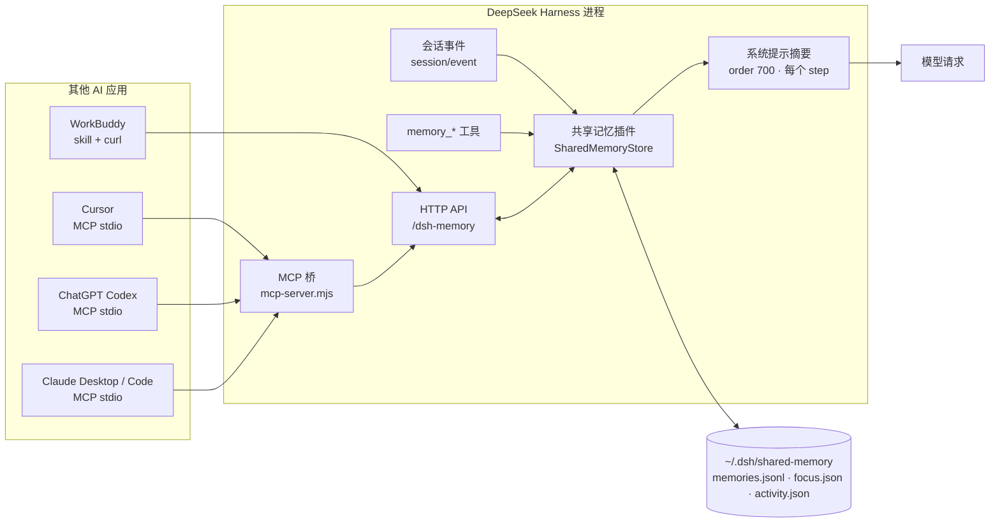

# AI 跨平台记忆增强 · Shared Memory

[English](README.en.md) | 中文

[](LICENSE)


**跨会话、跨 AI 应用、跨平台**的记忆增强层（DeepSeek Harness 插件形态）：让**所有会话**（包括不同工作区、不同会话）和**其他 AI 应用**共用同一份记忆 —— 记住用户说过的话、长期偏好、正在做的项目，以及“现在要做的事”。

- 形态：**DeepSeek Harness Host 插件（bundle）** + **零依赖 MCP stdio 桥** + **可复用 Agent Skill**
- 存储位置：`~/.dsh/shared-memory/`
- 包名 / 行 id：`@local/shared-memory` / `shared-memory`
- 版本：1.6.0 · License：MIT

> 原名 **共享记忆**，自 v1.0.0 起中文名改为 **AI 跨平台记忆增强 1.0**；**英文名保持 Shared Memory 不变**。内部标识（包名、skill id、存储目录）保持不变，不影响已有安装与数据。

> 注意：它**不是**一个单独的 Agent Skill。Skill 只是「客户端适配层」——让 WorkBuddy / 其他支持 skills 的 Agent 学会调用本插件暴露的 HTTP API。真正的记忆服务是 Harness 插件，其他应用通过 MCP 桥或 HTTP 接入。

## 仓库结构

```
├── index.js                  # Host 插件：捕获/存储/工具/提示注入/HTTP API
├── cordis.patch.yml          # bundle 行声明与默认 config
├── standalone/server.mjs     # 独立 Hub（不依赖 DSH，跨平台）
├── ui/index.html             # 浏览器查看/编辑页面（/dsh-memory/ui）
├── mcp/server.mjs            # 零依赖 MCP stdio 桥（复制到 ~/.dsh/shared-memory/）
├── skills/shared-memory/     # 可复用 Agent Skill（WorkBuddy 等）
│   └── SKILL.md
├── docs/API.md               # 冻结的 HTTP / 存储 / MCP 约定
├── docs/HOW-IT-WORKS.md      # 工作原理与设计说明
├── docs/CONNECT-APPS.md      # 各 AI 应用接入说明
├── docs/assets/architecture.svg
├── test/host-smoke.mjs       # Host 半集成测试
├── test/mcp-smoke.mjs        # MCP 协议冒烟测试（35 项断言）
├── test/standalone-smoke.mjs # 独立 Hub + 桥的端到端测试
├── .github/workflows/ci.yml  # 三平台 CI（macOS / Linux / Windows）
├── locale/en.json · zh.json  # 插件显示名
├── CHANGELOG.md
└── icon.svg
```

## 架构




> 设计取舍、数据流、生命周期、安全边界见 [docs/HOW-IT-WORKS.md](docs/HOW-IT-WORKS.md)。

## 两种运行方式

| 方式 | 需要 DSH | 能力 | 适合 |
|---|---|---|---|
| **DSH 插件**（默认） | ✅ | 自动捕获会话消息、系统提示注入、模型工具、HTTP、MCP | 日常在 DeepSeek Harness 里用 |
| **独立 Hub** `standalone/server.mjs` | ❌ | 存储 / 搜索 / 当前焦点 / HTTP API / MCP（**无**自动捕获与提示注入） | Windows、Linux、服务器、不想装 DSH |

两者读写**同一份** store（默认 `~/.dsh/shared-memory/`），并写同一份 `runtime.json`，所以 MCP 桥、Cursor、Codex、WorkBuddy 的配置完全不用改。

> ⚠️ 同一个 store 目录**只能运行其中一个**（插件或 Hub），不要同时跑——单写者假设会被破坏。

### 快速开始（独立 Hub，跨平台）

要求：Node.js ≥ 18，无其他依赖。

```bash
git clone https://github.com/shadyyoung/dsh-shared-memory.git
cd dsh-shared-memory
node standalone/server.mjs            # http://127.0.0.1:7400/dsh-memory
# 或指定端口/地址/存储目录
node standalone/server.mjs --port 7400 --host 127.0.0.1 --store ~/.dsh/shared-memory
```

启动后：

- HTTP：`http://127.0.0.1:7400/dsh-memory`（`/health`、`/api/*` 同契约，见 [docs/API.md](docs/API.md)）
- MCP：`node ~/.dsh/shared-memory/mcp-server.mjs`（Hub 启动时会把桥复制到 store 目录并写 `runtime.json`）
- 数据：`~/.dsh/shared-memory/`

## 安装

前置：DeepSeek Harness Desktop（含 `plugin_manager` / Cordis 插件体系）、Node.js ≥ 18。

1. 克隆本仓库到任意目录：
   ```bash
   git clone https://github.com/shadyyoung/dsh-shared-memory.git
   ```
2. 用绝对路径安装 bundle（Harness 的 `plugin_manager` 工具或设置页）：
   ```
   plugin_manager: install_bundle  target=/绝对路径/dsh-shared-memory
   ```
   安装后用 `cordis_inspect_query` 的 `Tool.listTools` 应能看到 `memory_remember` / `memory_search` / `memory_forget` / `memory_current`。
3. 其他 AI 应用接入：见 [docs/CONNECT-APPS.md](docs/CONNECT-APPS.md)（MCP 桥路径是 `~/.dsh/shared-memory/mcp-server.mjs`，由插件激活时自动复制）。
4. 可选：把 `skills/shared-memory/SKILL.md` 复制到支持 skills 的 Agent，例如 WorkBuddy：
   ```bash
   mkdir -p ~/.workbuddy/skills/shared-memory
   cp skills/shared-memory/SKILL.md ~/.workbuddy/skills/shared-memory/
   ```

## 兼容性

- **独立 Hub**：macOS / Linux / Windows + Node.js ≥ 18；CI 三平台矩阵（`ubuntu-latest` / `windows-latest` / `macos-latest`）实测。
- **DSH 插件**：DeepSeek Harness Desktop（`desktop` profile，插件 API 0.2.x），随 DSH 支持的平台走；插件本身无 npm 依赖。
- 已验证接入：DeepSeek Harness 所有会话（读写）、WorkBuddy（读写）、Cursor（读写）、ChatGPT 桌面版 Codex（读写）。
- 未支持：ChatGPT 纯聊天窗口 / 网页版（只支持远程 Connector）。

## 能力

| 能力 | 说明 |
|---|---|
| 自动捕获用户消息 | 监听 `session/event` 的 `user/message` 写成**短期原话缓存**（默认 30 天过期，跳过子代理与合成消息）；长期记忆只由模型主动 `memory_remember` 写入 |
| 当前焦点 | 用户一说新的实质任务就自动更新（过滤“继续/再来一次”这类短句），也可由模型/任意应用显式设置 |
| 会话动态 | 每条根会话的最近用户消息、最近助手回复、消息数、目录、标题，跨会话可见 |
| 系统提示注入 | 每个模型请求前注入 `## 共享记忆` 摘要（≤1200 字符，`<memory-data>` 围栏 + 注入过滤），并用当前话题**按 BM25 相关性**挑出「相关记忆」一起注入 |
| 模型工具 | `memory_remember` / `memory_search` / `memory_forget` / `memory_update` / `memory_restore` / `memory_current` |
| 查看编辑 UI | `/dsh-memory/ui`：搜索高亮、相关性/最新排序、编辑、回收站/恢复/清空、编辑历史、使用次数、**备份/恢复**、导出 JSONL |
| 自动备份 | 默认每 24 小时把全量数据 gzip 快照到 `~/.dsh/shared-memory-backups/`（保留 14 份），UI 可手动备份/一键恢复 |
| 自动抽取 | 抓取用户消息里的长期事实（规则模式默认、免费；可切 `llm` 用模型抽取），先进「待确认」收件箱，UI 一键接受/编辑/拒绝 |
| 导入历史 | 支持 ChatGPT / Claude 导出的 `conversations.json`、jsonl、txt/md，导入为原话并自动生成候选记忆 |
| PII 脱敏 | 写入前识别 `sk-*`、`ghp_*`、`AKIA*`、Bearer、`password=`、身份证号等，默认替换为 `[已脱敏]` |
| 接入自检 | `npm run doctor`（或 `node scripts/doctor.mjs`）逐项检查 DSH 服务 / MCP 桥 / Cursor / Codex / Claude Desktop / WorkBuddy |
| 检索 | **BM25 倒排索引**（中文 bigram + 英文词），相关性排序，标签参与索引；支持 `sort=relevance|newest` |
| HTTP API | `http://127.0.0.1:<端口>/dsh-memory`（端口随 Harness 启动变化，见 `runtime.json`） |
| MCP 桥 | `~/.dsh/shared-memory/mcp-server.mjs`，零依赖 stdio MCP 服务，供 Claude Desktop / Claude Code / Cursor / Codex 等接入 |

## 演示

```text
$ node ~/.dsh/shared-memory/mcp-server.mjs
# MCP initialize → tools/call memory_status
共享记忆服务运行中（dsh-shared-memory v1.1.0）
地址：http://127.0.0.1:57545/dsh-memory（来源：runtime.json）
存储目录：/Users/you/.dsh/shared-memory
统计：34 条记忆 / 18 条原话 / 3 个会话 / 当前焦点：有

# tools/call memory_search { "q": "插件" }
查询“插件”：共 3 条，显示 3 条

- [project · 12 分钟前] 共享记忆插件已开源到 GitHub…
- [note · 1 小时前] 首次安装失败原因：output.schema 用了参数 DSL 的 required 写法…
- [profile · 2 小时前] 用户偏好中文、希望所有 AI 共用一份记忆…
```

任何一端说「记住：…」或写入一条记忆，其余会话的下一个 step 就会在系统提示摘要里看到它。

## 查看与编辑（UI）

浏览器打开服务地址下的 **`/ui`** 即可（DSH 插件和独立 Hub 都提供同一个页面）：

```
http://127.0.0.1:<端口>/dsh-memory/ui
# 独立 Hub 默认：http://127.0.0.1:7400/dsh-memory/ui
```

- 统计信息、当前焦点编辑（focus + 下一步）
- 记忆列表：搜索、按 kind 过滤、加载更多、编辑（正文/类型/标签）、删除
- `message` 原话缓存**只读**（可移到回收站），避免破坏"原话"语义
- **相关性摘要**：摘要里新增「相关记忆（与当前话题）」，用最近一条用户消息/当前焦点做 BM25 查询召回
- **使用统计**：返回/注入过的记忆累计使用次数，参与相关性加权，UI 显示"用过 N 次"
- **回收站**：支持一键清空（`POST /api/purge-trash`）
- **备份与恢复**：快照包含记录/焦点/动态/使用统计；恢复前会自动把当前状态再备份一份，误操作也能回退
- **回收站**：删除默认是软删除（`trashRetentionDays` 天后彻底清理），可一键恢复或彻底删除
- **编辑历史**：每次编辑保留上一版，可查看并恢复任意历史版本
- 一键导出 JSONL 备份
- 设置过 `apiToken` 时，页面会提示输入 token（只存在浏览器 localStorage）

界面是纯静态 HTML/CSS/JS，无构建步骤；同源访问 API，所以也不需要改 CORS。

## 接入其他 AI 应用

看生成好的说明：`~/.dsh/shared-memory/CONNECT-APPS.md`（源码版：[docs/CONNECT-APPS.md](docs/CONNECT-APPS.md)）。三步：

1. 打开 DeepSeek Harness（HTTP API 跑在 Harness 进程里）。
2. 在各应用里配置 MCP：命令 `/usr/local/bin/node`，参数 `~/.dsh/shared-memory/mcp-server.mjs`。
3. 让应用调用 `memory_status` 验证；之后它就能看到并写入同一份记忆。

## 存储格式

```
~/.dsh/shared-memory/
├── memories.jsonl    # 一行一条记忆（唯一写者是 Harness 进程）
├── focus.json        # 当前焦点 + nextSteps
├── activity.json     # 每个根会话的最近动态
├── runtime.json      # 插件激活时写入的 API 地址/端口/token（其他应用据此发现服务）
├── mcp-server.mjs    # MCP 桥（随插件版本更新）
├── CONNECT-APPS.md   # 接入说明
├── digest.md         # 人类可读快照（每隔几秒重写）
├── README.md
└── token             # 仅当 config.apiToken 非空
```

记忆记录：`{ id, kind, text, tags, source:{app,sessionId,cwd,title}, createdAt }`，`kind ∈ note/profile/preference/goal/project/task/message`。相同 `kind + text` 自动去重。

## 配置

改 `~/.dsh/profiles/desktop/package.json` 里 bundle 的配置不会生效——本插件通过自己的 `cordis.patch.yml` 插入行并携带 config。要调参，修改本目录的 [cordis.patch.yml](cordis.patch.yml) 后重新安装/启用 bundle。

| 字段 | 默认 | 说明 |
|---|---|---|
| `storeDir` | `~/.dsh/shared-memory` | 存储目录 |
| `captureUserMessages` | `true` | 自动捕获根会话的用户消息（短期原话缓存，非长期记忆） |
| `messageRetentionDays` | `30` | 原话缓存保留天数，0=永久；过期只删 message，不删主动记忆 |
| `promptDigest` | `true` | 把共享记忆摘要注入系统提示 |
| `maxDigestChars` | `1200` | 摘要注入上限 |
| `maxStoredMessages` | `3000` | 原话缓存的条数上限（超出丢最旧） |
| `maxActivitySessions` | `200` | 会话动态保留的会话数上限 |
| `apiEnabled` | `true` | 是否注册 HTTP 路由 |
| `apiPath` | `/dsh-memory` | 路由前缀 |
| `apiToken` | `""` | 非空则要求 `Authorization: Bearer <token>` |
| `autoFocusMinutes` | `90` | 自动焦点的过期/刷新间隔，0 关闭自动焦点 |
| `writeHumanDigest` | `true` | 是否写 `digest.md` |
| `trashRetentionDays` | `30` | 回收站保留天数，0=永久保留（需手动彻底删除） |
| `maxRevisions` | `20` | 每条记忆保留的历史版本数，0=不保留 |
| `maxRelevantMemories` | `4` | 摘要里「相关记忆」条数，0=关闭 |
| `backupDir` | `~/.dsh/shared-memory-backups` | 备份目录（默认在存储目录之外，删库也不会丢；可指到 iCloud/Dropbox） |
| `backupKeep` | `14` | 保留最近 N 份备份，自动清理更旧的 |
| `autoBackupHours` | `24` | 自动备份间隔（小时），0=关闭自动备份 |
| `autoExtract` | `rules` | 自动抽取：`off` / `rules`（免费规则）/ `llm`（模型抽取） |
| `extractModel` | 空 | 模型抽取用的 provider/model；空=用默认模型（可指定便宜模型省成本） |
| `maxExtractPerDay` | `30` | 每日模型抽取次数上限（成本闸门） |
| `piiPolicy` | `redact` | `off` 不处理 / `warn` 只标记 / `redact` 写入前脱敏 |

## 验证

```bash
# 1. 服务健康（端口从 ~/.dsh/shared-memory/runtime.json 读取）
curl -s "$(node -e "console.log(require(process.env.HOME+'/.dsh/shared-memory/runtime.json').apiBase)")/health"

# 2. 本地单元/集成测试（不依赖正在运行的 Harness）
node test/host-smoke.mjs       # 工具、捕获、提示摘要、HTTP API、鉴权
node test/mcp-smoke.mjs        # MCP 协议 35 项断言（自带 mock 服务）
node test/standalone-smoke.mjs # 独立 Hub + MCP 桥端到端（无需 Harness）
```

实测结果（2026-10-26）：两套测试全部通过；运行中的 Harness 上 HTTP `/health` 正常，MCP 桥 `memory_status` / `memory_search` / `memory_current` 可读写同一份数据，系统提示已注入共享记忆摘要。

## 已知失败记录（首次安装）

**现象**：`plugin_manager install_bundle` 返回 `application: failed`，诊断：

```
JsonSchemaError: unsupported JSON schema:
  schema.properties.item.properties.id.required is not supported on type "string"
  …
```

**原因**：`ctx.tools.register()` 的 `output.schema` 是**严格 JSON Schema 子集**，不是参数 DSL。首版把参数的写法（属性级 `required: true`）用在了 output 上；该子集要求 `required` 只能是对象级字符串数组，且不能出现在 string/number/array 等类型上。

**修复**：四个工具的 output schema 改为标准 JSON Schema（对象级 `required: [...]` + `properties`，可空焦点用 `oneOf: [object, null]`）；随后 `set_bundle(false)` → `set_bundle(true)` 重新激活，返回 `application: applied`。

同期修复的另外两个问题：

1. `forget()` 在写队列里再次入队导致自锁（删除记忆会永久挂起）——改为直接 `await #rewriteMemories()`。
2. 自动焦点会被“继续 / 再来一次”这类短句覆盖——新增 `isSubstantiveTask()` 过滤（≥8 字符、非寒暄/续跑短句）。该启发式改动需重启 Harness（或重新启用 bundle）后才在新进程里生效。

## 限制与说明

- 没有独立的 Web UI 面板：记忆的查看/编辑通过工具、HTTP API、`digest.md`，或直接看 `memories.jsonl`。
- HTTP 服务依附 Harness 进程：Harness 未运行时，MCP 桥会返回“服务未运行”的可读错误；启动 Harness 后自动恢复，不需要重启其他应用。
- 默认只监听本机；需要跨机器访问时请自行加 `apiToken` 并处理端口暴露。
- 记忆是明文 JSONL（`~/.dsh/shared-memory/`），包含用户消息原文；不希望落盘的场景可用 `captureUserMessages: false`。

## 变更记录

见 [CHANGELOG.md](CHANGELOG.md)。
