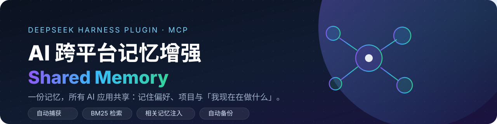
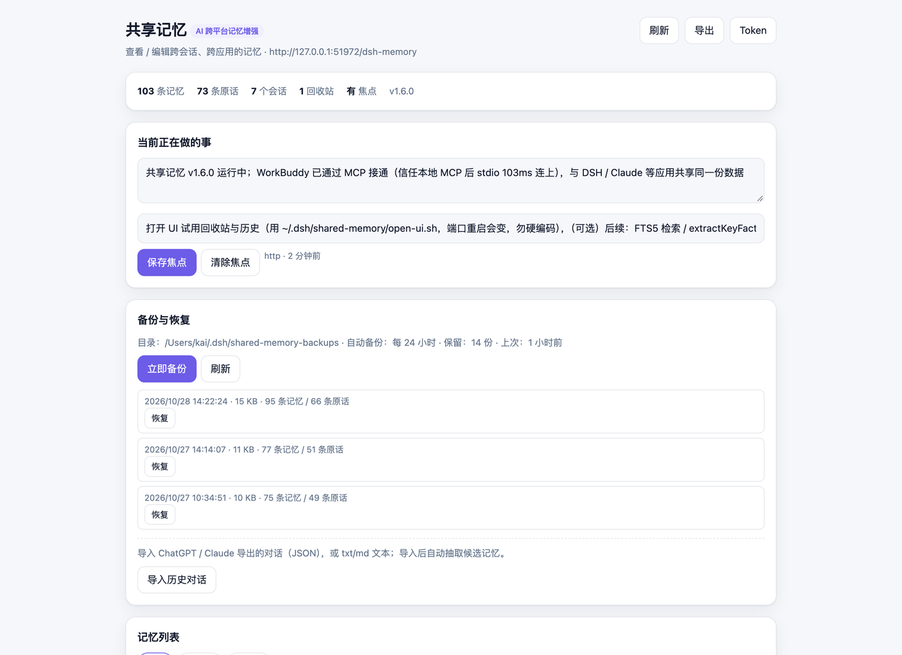
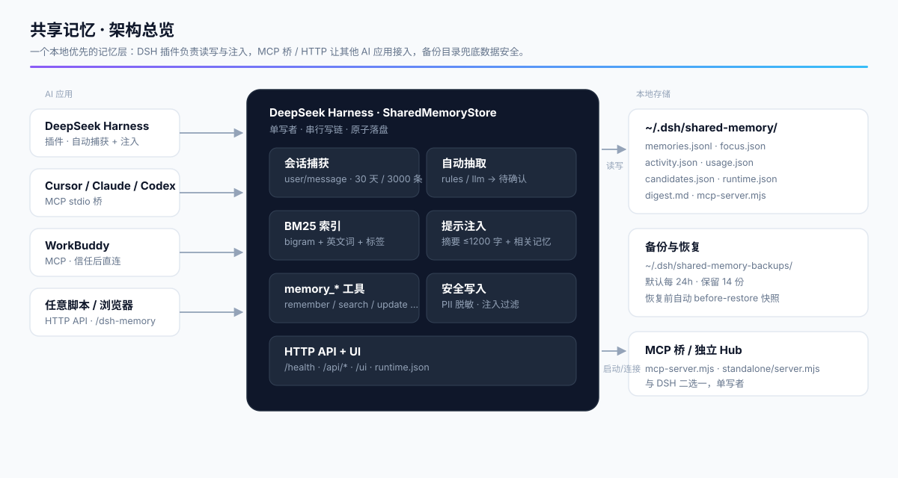

<p align="center">
  <a href="https://github.com/shadyyoung/dsh-shared-memory/releases">
    
  </a>
</p>

<h1 align="center">AI 跨平台记忆增强 · Shared Memory</h1>

<p align="center">
  <b>一份记忆，所有 AI 应用共享。</b><br>
  记住你的偏好、项目和「我现在在做什么」——跨会话、跨工作区、跨应用。
</p>

<p align="center">
  <a href="https://github.com/shadyyoung/dsh-shared-memory/releases"></a>
  <a href="https://github.com/shadyyoung/dsh-shared-memory/actions/workflows/ci.yml"></a>
  
  = 18">
  
  
</p>

<p align="center">
  <a href="docs/API.md">API 契约</a> ·
  <a href="docs/HOW-IT-WORKS.md">工作原理</a> ·
  <a href="docs/CONNECT-APPS.md">应用接入</a> ·
  <a href="CHANGELOG.md">更新日志</a> ·
  <a href="README.en.md">English</a>
</p>

---

## 这是什么

一个**本地优先**的共享记忆层，目前以 **DeepSeek Harness 插件**形态运行，并提供 **MCP stdio 桥** 与 **HTTP API**，让 Cursor、Claude Desktop、ChatGPT 桌面版、WorkBuddy 等应用读写同一份记忆。

它做的四件事：

| | 能力 | 效果 |
|---|---|---|
| 🎯 | **自动捕获** | 每个会话的用户消息、当前焦点、会话动态自动入库 |
| 🧠 | **自动抽取** | 从对话里挑出偏好/身份/目标/项目 → 进「待确认」收件箱，接受才落库 |
| 🔍 | **BM25 检索** | 中文 bigram + 英文词 + 标签倒排索引，相关性排序 |
| 💉 | **相关性注入** | 每个模型请求前注入摘要（≤1200 字）+ 按当前话题召回的相关记忆 |

> [!NOTE]
> **它不是 Agent Skill。** Skill 只是给 WorkBuddy 等客户端的适配层；真正的记忆服务是 DSH 插件 / 独立 Hub，其他应用通过 MCP 桥或 HTTP 接入。

> [!IMPORTANT]
> **单写者**：同一个 store 目录只能运行「DSH 插件」或「独立 Hub」其中一个，不要同时跑。

## 界面

<p align="center">
  
</p>

浏览器打开 `/dsh-memory/ui`（地址随 DSH 端口变化，用 `node -e 'console.log(require(process.env.HOME+"/.dsh/shared-memory/runtime.json").origin)'` 或 `~/.dsh/shared-memory/open-ui.sh` 获取）：

- 记忆/回收站/待确认三个视图，搜索高亮 + 相关性/最新排序
- 编辑、软删除、恢复、彻底删除、编辑历史回滚
- 当前焦点编辑、JSONL 导出
- 备份/恢复、导入 ChatGPT/Claude 历史对话
- 统计：记忆数、原话数、回收站数、会话数、使用次数

## 快速开始

### 方式 A：装进 DeepSeek Harness（推荐）

前置：DeepSeek Harness Desktop、Node.js ≥ 18。

```bash
git clone https://github.com/shadyyoung/dsh-shared-memory.git
```

在 DSH 里用 `plugin_manager` 安装 bundle（绝对路径）：

```text
plugin_manager: install_bundle  target=/绝对路径/dsh-shared-memory
```

确认工具已注册：

```text
cordis_inspect_query: Tool.listTools   # 应看到 memory_remember / memory_search / …
```

> [!TIP]
> 修改插件源码后必须**重启 Harness** 才会生效（HMR 注册的 schema 可能与真实环境不一致），不要只靠热重载。

### 方式 B：让其他 AI 应用「打开即用」

```bash
cd dsh-shared-memory
npm run install-apps    # 自动检测并写入 Cursor / Claude Desktop / Codex / Claude Code / WorkBuddy(MCP+skill)
npm run autostart       # 可选：登录 macOS 自动打开 DSH，服务常驻
npm run doctor          # 逐项检查服务、MCP 桥握手、各应用配置
```

- `install-apps` 会**先备份**再写配置；新装 AI 应用后重跑一次即可。
- 已在运行的应用需要 **`Cmd+Q` 完全退出再打开**才会加载 MCP（应用自身限制）。
- `npm run autostart:uninstall` 可移除登录项。

### 方式 C：独立 Hub（不依赖 DSH，跨平台）

```bash
git clone https://github.com/shadyyoung/dsh-shared-memory.git
cd dsh-shared-memory
node standalone/server.mjs                       # http://127.0.0.1:7400/dsh-memory
node standalone/server.mjs --port 7400 --store ~/.dsh/shared-memory
```

独立 Hub 提供存储 / 检索 / HTTP / MCP，但**没有**自动捕获与提示注入。

## 接入矩阵

| 应用 | 接入方式 | 读写 | 说明 |
|---|---|---|---|
| DeepSeek Harness | 内置插件 | ✅ | 自动捕获 + 注入 + 6 个工具 |
| Cursor | MCP stdio | ✅ | `~/.cursor/mcp.json` |
| Claude Desktop | MCP stdio | ✅ | `claude_desktop_config.json` |
| Claude Code | MCP stdio | ✅ | `~/.claude.json` |
| ChatGPT 桌面（Codex） | MCP stdio | ✅ | `~/.codex/config.toml` |
| WorkBuddy | MCP stdio + skill | ✅ | `~/.workbuddy/mcp.json`；需在界面信任一次本地 MCP |
| 任意脚本 / 浏览器 | HTTP | ✅ | `/dsh-memory/api/*` |
| ChatGPT 网页 / 纯聊天 | ❌ | — | 只支持远程 Connector，无法读本地 MCP |

## 工具

**DSH 模型工具（6 个）**：`memory_remember` · `memory_search` · `memory_forget` · `memory_update` · `memory_restore` · `memory_current`

**MCP 工具（7 个）**：上述 6 个（`memory_restore` 也可用）+ `memory_digest` · `memory_status`

| 工具 | 作用 |
|---|---|
| `memory_remember` | 写入长期记忆（note/profile/preference/goal/project/task），相同内容自动去重 |
| `memory_search` | BM25 检索，`sort=relevance/newest`，可按 kind/tag/天数过滤 |
| `memory_forget` | 默认软删除到回收站；`purge: true` 彻底删除 |
| `memory_update` | 原地编辑，保留 id/创建时间，自动记录历史版本 |
| `memory_restore` | 从回收站恢复 |
| `memory_current` | 读写「当前焦点 + 下一步」，跨会话共享 |
| `memory_digest` | 获取 Markdown 摘要，可直接放进上下文 |
| `memory_status` | 健康检查（版本、存储目录、统计） |

## HTTP API 摘要

完整契约见 [docs/API.md](docs/API.md)。前缀 `/dsh-memory`：

| 方法 | 路径 | 用途 |
|---|---|---|
| GET | `/health` | 健康检查 + 统计 |
| GET | `/api/digest?maxChars=` | Markdown 摘要 |
| GET | `/api/search?q=&kind=&tag=&sort=` | 检索 |
| GET | `/api/items?q=&kind=&deleted=1&includeDeleted=1` | 列表（含回收站） |
| GET/POST | `/api/current` | 读 / 写当前焦点 |
| POST | `/api/remember` | 写入记忆 |
| POST | `/api/forget` | 软删除 / `purge` 彻底删除 |
| POST | `/api/restore` · `/api/purge-trash` | 恢复 / 清空回收站 |
| POST | `/api/update` | 编辑 |
| GET/POST | `/api/candidates` · `/api/candidates/accept` 等 | 待确认候选 |
| POST | `/api/import` | 导入 ChatGPT/Claude/jsonl/txt |
| GET/POST | `/api/backups` · `/api/backup` · `/api/restore-backup` | 备份/恢复 |
| GET | `/api/export` | 导出 JSONL |
| GET | `/ui` | 浏览器界面 |

## 配置

插件配置在 [cordis.patch.yml](cordis.patch.yml)，改完重新安装/启用 bundle 生效。

| 字段 | 默认 | 说明 |
|---|---|---|
| `storeDir` | `~/.dsh/shared-memory` | 存储目录 |
| `captureUserMessages` | `true` | 自动捕获根会话用户消息（短期原话缓存） |
| `messageRetentionDays` | `30` | 原话保留天数，0=永久；过期只删 message |
| `maxStoredMessages` | `3000` | 原话条数上限 |
| `promptDigest` | `true` | 是否注入系统提示 |
| `maxDigestChars` | `1200` | 摘要注入上限 |
| `maxRelevantMemories` | `4` | 摘要里「相关记忆」条数，0=关闭 |
| `autoFocusMinutes` | `90` | 自动焦点刷新间隔，0=关闭 |
| `trashRetentionDays` | `30` | 回收站保留天数，0=永久 |
| `maxRevisions` | `20` | 编辑历史版本数，0=不保留 |
| `backupDir` | `~/.dsh/shared-memory-backups` | 备份目录（在 store 之外，可指到 iCloud/Dropbox） |
| `backupKeep` | `14` | 保留备份数 |
| `autoBackupHours` | `24` | 自动备份间隔，0=关闭 |
| `autoExtract` | `rules` | `off` / `rules`（免费）/ `llm`（模型抽取） |
| `extractModel` | 空 | 模型抽取使用的 provider/model，空=默认模型 |
| `maxExtractPerDay` | `30` | 每日模型抽取次数上限（成本闸门） |
| `piiPolicy` | `redact` | `off` / `warn` / `redact` |
| `apiEnabled` | `true` | 是否注册 HTTP 路由 |
| `apiPath` | `/dsh-memory` | 路由前缀 |
| `apiToken` | `""` | 非空则要求 `Authorization: Bearer <token>` |

## 架构

<p align="center">
  
</p>

数据流：`session/event` → 捕获/抽取 → `memories.jsonl`（+ 索引）→ 摘要注入 / 工具 / HTTP → 其他应用。
备份目录独立于 store，默认 24h 自动快照、保留 14 份，恢复前还会再存一份 `before-restore`。
细节见 [docs/HOW-IT-WORKS.md](docs/HOW-IT-WORKS.md)。

## 测试与 CI

```bash
node test/host-smoke.mjs        # 插件 + HTTP + UI 半集成测试
node test/mcp-smoke.mjs         # MCP 协议冒烟（36 项断言）
node test/standalone-smoke.mjs  # 独立 Hub + 桥端到端
node test/search-bench.mjs      # 10k 条 BM25 索引/查询基准
npm run doctor                  # 各应用接入自检
```

CI：GitHub Actions 三平台矩阵（`ubuntu-latest` / `macos-latest` / `windows-latest` × Node 20/22），全部通过。

## 仓库结构

```text
shared-memory/
├── index.js                    # Host 插件：存储/捕获/抽取/注入/工具/HTTP/UI
├── cordis.patch.yml            # bundle 声明与默认配置
├── standalone/server.mjs       # 独立 Hub（无 DSH 依赖）
├── ui/index.html               # 浏览器 UI（单文件）
├── mcp/server.mjs              # 零依赖 MCP stdio 桥
├── skills/shared-memory/       # Agent Skill（WorkBuddy 等）
├── scripts/
│   ├── install-apps.mjs        # 一键写入各应用 MCP 配置
│   ├── autostart.mjs           # macOS 登录项
│   └── doctor.mjs              # 接入自检
├── docs/
│   ├── API.md                  # HTTP / 存储 / MCP 契约
│   ├── HOW-IT-WORKS.md         # 工作原理
│   ├── CONNECT-APPS.md         # 应用接入
│   └── assets/                 # banner / 架构图 / UI 截图
├── test/                       # host / mcp / standalone / bench
├── .github/workflows/ci.yml
└── CHANGELOG.md
```

## FAQ

<details>
<summary><b>为什么其他应用改了配置必须重启？</b></summary>

MCP 配置只在应用启动时读取，应用没有热加载机制。`Cmd+Q` 完全退出（不是关窗口）再打开即可。
</details>

<details>
<summary><b>原话会永久保存吗？</b></summary>

不会。原话默认 30 天过期（`messageRetentionDays`），长期记忆（profile/preference/project 等）永久保留，直到你删除。想要永久记住某件事，直接说「记住：…」。
</details>

<details>
<summary><b>DSH 关了，其他应用还能用吗？</b></summary>

不能，服务宿主是 DSH。装 `npm run autostart` 让登录时自动启动；或改用独立 Hub 常驻。
</details>

<details>
<summary><b>数据和隐私？</b></summary>

全部存在本机 `~/.dsh/shared-memory/`，默认只监听回环地址；可设 `apiToken`；写入前自动脱敏常见密钥/身份证号（`piiPolicy`）。
</details>

## License

[MIT](LICENSE) · 文档与截图随仓库一起开源。
